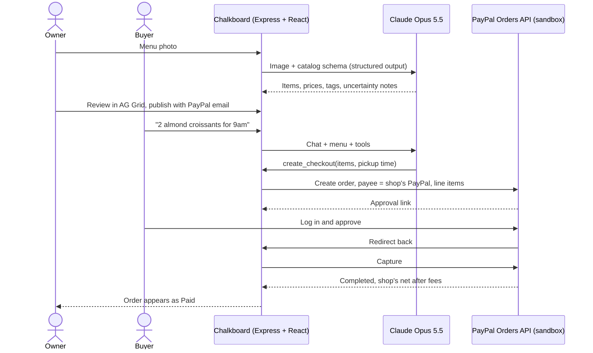

# Chalkboard

**From a chalkboard menu to a shop AI assistants can buy from, paid with PayPal.**

Snap a photo of your menu board. Claude reads it into a catalog, you check it in a table, and you publish. Customers (or their AI assistants) ask questions and order in plain words, and every payment goes straight to the shop's own PayPal account.

- **Live demo:** _add the Render URL here after deploying_ ([try the sample shop](#try-it))
- **Demo video:** _add the YouTube link here_
- Built for the [PayPal AI Hackathon](https://paypalaihackathon.devpost.com/) · PayPal **sandbox** only · MIT licensed

## Why

AI assistants are starting to shop for people, and PayPal is making merchants "agent-ready" so assistants can find products and hand buyers off to a trusted checkout. That works for shops that already have an online catalog. The bakery, food truck or market stall down the street has a chalkboard, not a catalog, so AI shoppers can't buy from it at all.

Chalkboard is the on-ramp for those shops: one photo, a couple of minutes of review, and they're selling through AI with PayPal checkout, without building a website.

## What it does

1. **Photo to catalog.** The owner uploads a photo of the menu. Claude reads it into structured items: names, prices, categories and dietary tags, with one item per size. Anything it isn't sure about (a smudged price, a half-erased name) is flagged with the reason.
2. **Review in a grid.** The draft opens in an editable AG Grid table. Flagged cells are highlighted, and hovering one shows why, e.g. *"price smudged: 4.30 or 4.80"*. Editing a cell confirms it.
3. **Publish.** The owner enters the PayPal email that should get paid and publishes. They get a public shop page and a private dashboard link.
4. **Order with AI.** On the shop page, customers chat with the shop's ordering assistant: "anything vegan?", "two almond croissants and a latte for 9am". It answers only from the menu, turns down sold-out items with an alternative, and creates a PayPal checkout.
5. **Pay the shop directly.** The buyer approves in PayPal. The money is captured into the **shop's** PayPal account, not Chalkboard's, using the Orders API `payee`.
6. **Owner dashboard.** Orders arrive live in an AG Grid table, and the status cell flashes when a payment lands. Unticking "On sale" takes an item off the menu, and the assistant stops selling it.

## Try it

On the hosted demo (the free Render plan sleeps when idle, so the first load can take up to a minute):

| | |
| --- | --- |
| Sample shop | `/s/rosas-bakery` |
| Sample shop's owner dashboard | `/s/rosas-bakery/manage?key=demo` |
| Make your own shop | `/`, then click **Try a sample menu**, or upload any menu photo |

To pay, you need a **PayPal sandbox Personal (buyer) account**. Sandbox money isn't real.

- Use a buyer account from your own [PayPal Developer Dashboard](https://developer.paypal.com/dashboard/accounts) (Testing Tools → Sandbox Accounts).
- Create it with country **United States**. PayPal doesn't support payments within India, so sandbox accounts set to India can fail.

A good path through the demo:

1. Open the sample shop and ask the assistant *"What do you have that's vegan?"*
2. Order: *"A morning bun and a 12 oz latte for pickup at 8:30, name Sam."*
3. Click **Pay with PayPal**, log in as your sandbox buyer and pay.
4. Watch the order card switch to **Paid**, then open the owner dashboard and see the order and what the shop receives after fees.

## How it works



**Trust boundaries.** The AI never handles money:
- **Prices:** Claude chooses item ids and quantities, and the server recalculates every price and the total from the shop's menu before creating the PayPal order.
- **Approval:** buyers always approve payment on PayPal's own page.
- **Capture:** an order is marked paid only after the server captures it with PayPal.
- **Missed returns:** if the buyer closes PayPal before being sent back, the next status check captures the approved payment.

## Tools used

| Tool | How Chalkboard uses it |
| --- | --- |
| **PayPal Orders API v2** (sandbox) | Creates an order per checkout with line items and an item total. Sets `payee.email_address` so each shop is paid directly ([pay another account](https://developer.paypal.com/docs/checkout/standard/customize/pay-another-account/)). Then the buyer approves through `payer-action`, the server captures, and it reads `seller_receivable_breakdown` to show the shop's net after fees. `npm run check:payee` verifies the routing end to end. |
| **Claude Opus 5.5** (Anthropic API, TypeScript SDK) | **Menu reading:** vision input with structured outputs against a Zod schema, including per-field uncertainty. **Ordering assistant:** tool use with two strict tools, `create_checkout` and `check_order`, and prompt caching on the shop's menu. Requests opt into server-side refusal fallbacks. |
| **AG Grid Community** | The editable menu review grid (uncertain cells highlighted with tooltips, boolean "On sale" column) and the live orders table (status cells flash when payment arrives). |
| **Render** | Hosting through `render.yaml`. |
| React, Vite, Express, Node.js 24 | Node runs the TypeScript server directly, with no build step for the server. |

## Run it locally

Requirements: Node.js 22.18 or newer, a free [PayPal Developer](https://developer.paypal.com) account, and a [Claude API key](https://console.anthropic.com).

**1. Set up the PayPal sandbox** in the [Developer Dashboard](https://developer.paypal.com/dashboard/):

- **Apps & Credentials → Sandbox:** copy your app's Client ID and Secret.
- **Testing Tools → Sandbox Accounts → Create account:**
  - one **Business** account to play the shop
  - one **Personal** account to pay as the buyer

  Choose **United States** for both. The Business account must not be the one that owns your app.

**2. Install and configure:**

```bash
npm install
cp .env.example .env
```

Fill in `.env`:

| Variable | Value |
| --- | --- |
| `PAYPAL_CLIENT_ID`, `PAYPAL_CLIENT_SECRET` | Your sandbox app's credentials |
| `ANTHROPIC_API_KEY` | Your Claude API key |
| `SAMPLE_SHOP_PAYPAL_EMAIL` | The sandbox Business account's email. This creates the sample shop. |
| `SHOP_PAYPAL_EMAIL` | The same email. Used only by `npm run check:payee`. |

**3. Optional: check that payments reach the shop.** This creates a $4.50 sandbox order paid to `SHOP_PAYPAL_EMAIL`, prints a link to approve it as the sandbox buyer, captures it, and confirms where the money landed.

```bash
npm run check:payee
```

**4. Run the app:**

```bash
npm run dev
```

Open http://localhost:4100. The sample shop is at http://localhost:4100/s/rosas-bakery.

## Deploy to Render

1. Push this repository to GitHub.
2. In Render, choose **New → Blueprint** and pick the repository. Render reads `render.yaml`.
3. Enter `PAYPAL_CLIENT_ID`, `PAYPAL_CLIENT_SECRET`, `ANTHROPIC_API_KEY` and `SAMPLE_SHOP_PAYPAL_EMAIL` when asked.

Render provides the public URL that PayPal sends buyers back to. Shops are stored in JSON files, and the free plan resets its disk when the service restarts. The sample shop is recreated on every start, but shops published on the demo don't survive a restart.

## Project layout

```
server/
  index.ts      HTTP routes, PayPal return handler, static hosting
  menu.ts       Photo → catalog with Claude (vision + structured outputs)
  agent.ts      The shop's ordering assistant (Claude tool use)
  orders.ts     Checkout creation and payment capture
  paypal.ts     Minimal PayPal REST client (OAuth, Orders v2)
  store.ts      Shops and orders, persisted as JSON
  sample.ts     Seeds the sample shop
shared/types.ts Types shared by server and web
web/src/        React app: upload & review, shop page with chat, receipt, owner dashboard
scripts/check-payee.ts  End-to-end check that payments reach the shop's account
```

## Limitations and next steps

- **Storage** is JSON files, which is fine for a demo. A real deployment would use a database.
- **One currency per shop**, taken from the menu. Tested with USD.
- **Next:** expose each shop as an MCP server, so assistants like Claude and ChatGPT can shop it directly. Also support PayPal's agent-ready checkout as it becomes available to more merchants, add PayPal webhooks for payment events, and let owners update the menu by text ("out of sourdough").

## License

[MIT](LICENSE)
